# Entity-relationship diagram (textual)

> A textual ER diagram for the `hogar_de_ancianos` schema. For a graphical view, generate it from the live DB with a tool like DBeaver, MySQL Workbench, or `mermaid` (Postgres).

---

## Diagram (Mermaid)

```mermaid
erDiagram
    USERS ||--o{ USER_SESSIONS : "has"
    USERS ||--o| USER_TWO_FACTOR : "has"
    USERS ||--o{ LOGIN_ATTEMPTS : "logs"
    USERS ||--o{ PASSWORD_RESET_TOKENS : "has"
    USERS ||--o{ EMAIL_VERIFICATION_TOKENS : "has"
    USERS }o--|| ROLES : "has"
    USERS ||--o{ ROLE_CHANGES : "history"
    USERS ||--o{ DIGITAL_RECORDS : "creates"
    USERS ||--o{ AUDIT_REPORTS : "authors"

    OLDER_ADULT ||--o{ OLDER_ADULT_FAMILY : "family"
    OLDER_ADULT ||--o{ EMERGENCY_CONTACTS : "contacts"
    OLDER_ADULT ||--o{ OLDER_ADULT_UPDATES : "history"
    OLDER_ADULT ||--o{ OLDER_ADULT_SUBPROGRAM : "enrolled"
    OLDER_ADULT ||--o{ CLINICAL_HISTORY : "has"
    OLDER_ADULT ||--o{ ENTRANCES_EXITS : "moves"
    OLDER_ADULT ||--o{ NURSING_RECORDS : "has"
    OLDER_ADULT ||--o{ SPECIALIZED_APPOINTMENTS : "scheduled"

    CLINICAL_HISTORY ||--o{ CLINICAL_HISTORY_AND_CONDITION : "M2M"
    CLINICAL_CONDITIONS ||--o{ CLINICAL_HISTORY_AND_CONDITION : "M2M"
    CLINICAL_HISTORY ||--o{ VACCINES_AND_CLINICAL_HISTORY : "M2M"
    VACCINES ||--o{ VACCINES_AND_CLINICAL_HISTORY : "M2M"

    PROGRAMS ||--o{ SUB_PROGRAMS : "has"
    SUB_PROGRAMS ||--o{ OLDER_ADULT_SUBPROGRAM : "enrolled"

    SPECIALIZED_AREAS ||--o{ SPECIALIZED_APPOINTMENTS : "in"
    NURSING_RECORDS ||--o{ SPECIALIZED_APPOINTMENTS : "relates"

    NOTIFICATIONS ||--o{ NOTIFICATION_ATTACHMENTS : "has"
    USERS ||--o{ NOTIFICATIONS : "receives"
```

---

## Key relationships in plain English

### User and roles
- A `User` has exactly one `Role` (FK `users.role_id → roles.id`).
- A `User` may have many `RoleChange` rows (history).
- A `User` has zero or one `UserTwoFactor` rows (2FA is opt-in).
- A `User` has many `UserSession` rows (active sessions).
- A `User` has many `LoginAttempt` rows (audit).
- A `User` has many `PasswordResetToken` and `EmailVerificationToken` rows.

### Older adult
- An `OlderAdult` is the resident. Singular table name (legacy).
- `OlderAdultFamily` and `EmergencyContact` are 1:N (an adult may have many family members and contacts).
- `OlderAdultUpdate` is 1:N (history of changes to the adult's record).
- `OlderAdultSubprogram` is M:N between `OlderAdult` and `SubProgram`.
- An `OlderAdult` may have one `ClinicalHistory` row (verify cardinality in the actual schema).
- An `OlderAdult` may have many `NursingRecord` and `SpecializedAppointment` rows.
- An `OlderAdult` may have many `EntranceExit` rows.

### Clinical history (M:N)
- `clinical_history_and_condition` is the M:N table between `clinical_history` and `clinical_conditions`.
- `vaccines_and_clinical_history` is the M:N table between `clinical_history` and `vaccines`.

### Programs
- `Programs` → `SubPrograms` is 1:N.
- `SubPrograms` → `OlderAdult` is M:N via `older_adult_subprogram`.

### Nursing
- `SpecializedArea` is the catalog (e.g. "Fisioterapia", "Psicología", "Trabajo Social").
- `SpecializedAppointment` references one `SpecializedArea` and one `OlderAdult`.
- `NursingRecord` may relate to one or more `SpecializedAppointment` (verify).

### Audit / notifications
- `DigitalRecord` is per-action (e.g. "Creación de expediente: ...").
- `AuditReport` is a generated report.
- `Notification` may have many `NotificationAttachment` rows.
- `Notification` targets a `User` (verify FK name).

---

## Cardinality cheat sheet

| Relationship | Cardinality |
|---|---|
| User — Role | N:1 |
| User — UserSession | 1:N |
| User — UserTwoFactor | 1:0..1 |
| User — LoginAttempt | 1:N |
| OlderAdult — Family | 1:N |
| OlderAdult — EmergencyContact | 1:N |
| OlderAdult — SubProgram (via older_adult_subprogram) | M:N |
| ClinicalHistory — ClinicalCondition (via clinical_history_and_condition) | M:N |
| ClinicalHistory — Vaccine (via vaccines_and_clinical_history) | M:N |
| Program — SubProgram | 1:N |
| SpecializedArea — SpecializedAppointment | 1:N |

---

## Indexes (high-traffic lookups)

- `users.u_email` (UNIQUE)
- `users.u_identification` (UNIQUE)
- `user_sessions(user_id, is_active)`
- `user_sessions(session_token)`
- `user_sessions(expires_at)`
- `login_attempts(email, attempted_at)`
- `login_attempts(ip_address, attempted_at)`
- `password_reset_tokens(token)`
- `password_reset_tokens(expires_at, used)`

For the full list, see `scriptDBCompleta.sql`.
